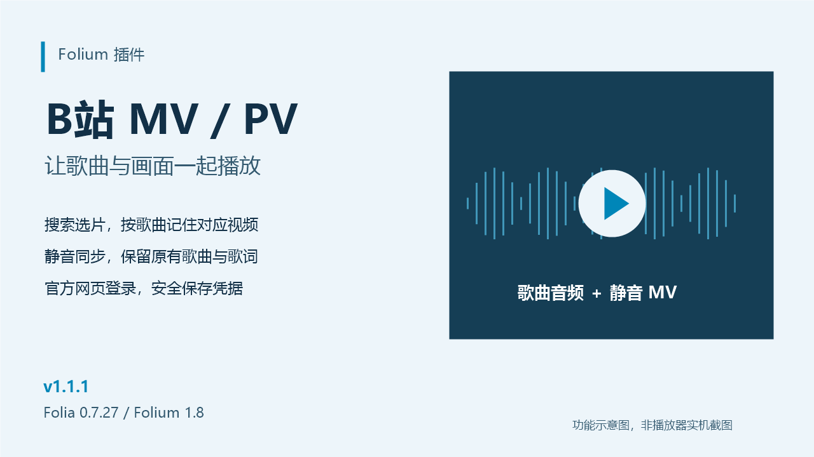

# B站 MV / PV · Folium 插件

在 Folia 播放歌曲时，从歌曲可视化的背景设置中搜索 B站 MV / PV，选择一个视频作为歌词背后的画面。

**音频仍由 Folia 播放，视频始终静音。** 插件不替换音源、不接管歌曲音量。



> 介绍图为功能示意，不是完整 Folia Electron 实机截图。

- 源码：[xinjiu-qwq/folium-bili-mv](https://github.com/xinjiu-qwq/folium-bili-mv)
- 安装包：[v1.1.1 Release](https://github.com/xinjiu-qwq/folium-bili-mv/releases/tag/v1.1.1) 中的 `bili-mv-1.1.1.zip`，不是 GitHub 自动生成的 Source code 压缩包。
- 模组 id：`bili-mv`；仓库根目录即模组目录，版本 tag 为 `v1.1.1`。
- 当前未签名，未提交模组市场审核；完整 Electron 登录/关闭流程仍需实机验证。

## 安装

适配本项目的 **Folia 0.7.27 / Folium 1.8**。仅桌面端支持 Folium。

### 当前源码开发版

插件已放在 `mods/bili-mv`。使用宿主的开发方式启动 Folia 后：

1. 打开 **设置 → 模组 → 模组系统**，开启模组系统。
2. 找到 **B站 MV / PV**，检查权限和代码来源，确认启用。
3. 播放歌曲，打开 **歌曲可视化设置 → 背景**，选择 **B站 MV**。

### 安装版 Folia

把完整的 `bili-mv` 文件夹复制到 Folia 的用户模组目录（`userData/mods`），或者将包含该文件夹的 ZIP 拖入模组管理面板。不要只复制 `client.mjs`；`main.cjs`、`lib/`、`client/` 和 `mod.json` 都是运行所需文件。

然后在模组面板启用插件，再按上面的路径选择背景。插件没有官方签名，会显示为“未验证”，这不等于无法安装。

## 登录 B站（1.1.0）

两个入口均可打开账号面板：

- **设置 → 模组 → B站 MV / PV → B站账号**。
- **歌曲可视化设置 → 背景 → B站 MV** 中的账号区域。

点击 **打开 B站登录窗口**，在 B站官方页面自行扫码或完成登录。插件使用独立窗口和会话，不会读取系统浏览器的登录数据，也不需要你把密码或 Cookie 发送给任何人。

登录完成后，插件在账号接口确认登录有效且安全保存凭据后自动关闭官方登录窗口。如果暂未自动关闭，可以点击账号面板的 **检查登录**。仅获取 Cookie 不代表账号已验证，未验证或保存失败时窗口保留供继续操作。

1.1.1 修正登录窗口关闭回调访问已销毁 Electron 对象的问题；手动关闭、自动关闭、退出登录和禁用清理共用安全关闭流程。

登录或退出后，旧的视频地址会作废。回到 MV 设置点击 **重试播放**，必要时重新搜索或选择视频。登录不能解除平台的版权、付费、地域或风控限制，也不能修复播放器缺少解码能力的问题。

**退出登录**会清除插件保存的凭据和独立会话数据，不影响你在系统浏览器中的 B站登录。若提示凭据存储损坏，先退出登录清除，再重新打开官方登录窗口。支持安全凭据存储的系统会加密保存最小登录 Cookie，便于重启恢复；无安全存储时只在当前会话保留。原始凭据不显示在面板，也不包含在插件 ZIP 中。

停用模组会关闭窗口并保留已经保存的登录凭据，不等同于退出账号。如需删除凭据，请先点击“退出登录”。停用期间正在完成的凭据写入会尽力回滚；宿主若已经撤销写权限，不能保证该回滚完成。

升级安装后请重新确认启用插件；宿主会对代码内容变化撤销旧的启用授权。已有逐曲 MV 绑定保留。

## 选择 MV

- 打开“B站 MV”背景的设置面板，确认当前歌曲。
- 默认关键词包含歌曲标题、歌手和 `MV`；可以修改为 `PV` 或更准确的曲名后搜索。
- 从结果中选择视频，多分P视频还需选择对应分P。
- 插件保存这首歌与所选视频的对应关系；下次播放同一首歌并使用此背景时自动恢复。
- “解除绑定”只删除当前歌曲的对应关系，不删除 B站视频或歌曲。

插件不擅自播放搜索结果第一项：同名歌曲、翻唱和剪辑版可能不同，请自行确认。

## 同步和画面

- 视频跟随歌曲暂停、继续和跳转，并周期性校正时间。
- **同步偏移的含义：视频时间 = 歌曲时间 + 偏移（秒）。** 正数表示视频提前，负数表示视频延后。
- 视频时间小于零时等待；歌曲播放位置超出视频时长时视频停止，不自动循环。
- 可以切换“完整显示 / 裁切铺满”，并调整暗化以保证歌词可读性。
- MV 与歌曲若来自不同剪辑版本，单个偏移无法修正中间增删片段；请换一个版本。

## 网络与限制

- 只尝试访问当前账号和网络有权播放的视频。登录使用插件专用的官方窗口，不读取系统浏览器 Cookie，不绕过付费、地域、版权或平台风控限制。
- B站接口并非本插件控制，可能返回风控、限流、地区限制或失效错误；搜索失败与空结果会区分显示。
- 采用可用的 AVC 视频轨；未登录时画质和可播内容可能受限。不是所有 B站视频都能播放。
- 视频地址临时解析，不持久化签名直链，也不下载整段视频文件。
- 仅在本机 `127.0.0.1` 随机端口提供带随机令牌的受限媒体流，不监听局域网；不提供任意 URL 代理。
- 不支持把在线 MV 随歌词导出。静态预览与导出上下文不加载在线视频。
- 没有对应视频、断网或视频加载失败时，不影响 Folia 原有歌曲音频。
- 仅播放你有权使用的内容；安装本插件不代表获得视频的下载、再分发或商用授权。

## 无法播放时

1. 先看 MV 面板的具体提示；需要登录时使用账号入口，完成后检查状态并重试播放。
2. 提示风控或限流时稍后再试，避免持续点击；登录不保证解除平台风控。
3. 提示无权限或视频不可用时换一个你有权播放的视频。
4. 提示网络错误时检查网络；提示解码或格式不支持时，登录不会解决该问题，请同时记录 Folia 版本和完整提示。
5. 登录窗口无法打开或页面登录失败时，保留错误提示反馈；不要发送密码、Cookie 或二维码确认凭据。

## 权限与数据

`main.cjs` 是运行在 Folia 主进程中的可信代码，具有 Node.js 能力，**不是沙箱**。启用前应审阅代码。

清单声明：

- `net.fetch`：表明联网用途；实际媒体流由 main 中的 Node 网络实现传输，避免将大文件塞进文本 RPC。
- `filesystem.data`：通过 Folium 存储 API 保存有界的逐曲绑定列表。

本插件不需要 `playback.control`，不会暂停、跳转或替换宿主歌曲。画面设置随宿主的背景参数持久化；逐曲绑定存放在插件自己的 Folium 数据中。登录凭据通过 Folium secrets 加密保存，不进入普通绑定数据、可视化配置导出或日志。只有固定的 B站 API 主机能收到凭据，视频 CDN 和本地媒体代理不携带 Cookie。

## 开发检查

要求 Node.js 24 或宿主所要求的更高版本。插件没有额外 npm 依赖，也无需单独构建。

本独立源码仓库根目录可直接运行测试：

```sh
node --test test/*.test.cjs test/*.test.mjs
node test/browser-smoke.mjs
```

需要在 Folia 宿主联调时，将仓库完整复制为宿主的 `mods/bili-mv`，然后在宿主项目根目录执行：

```sh
node --test mods/bili-mv/test/*.test.cjs mods/bili-mv/test/*.test.mjs
node dev/folium/check.mjs mods/bili-mv
```

真实浏览器 DOM 冒烟（默认使用已安装的 Windows Chrome，无额外 npm 依赖）：

```sh
node mods/bili-mv/test/browser-smoke.mjs
```

可用环境变量 `CHROME_PATH` 指定 Chromium 可执行文件。加 `--live` 会访问一个公开 B站示例视频，验证真实 AVC 流经本地代理后的元数据、seek 与静音播放；这会消耗网络流量，但不保存视频文件：

```sh
node mods/bili-mv/test/browser-smoke.mjs --live
```

启动桌面联调使用宿主的 `npm run dev:electron`（需先安装宿主依赖）。

单元/本地模拟测试不等同于真实 B站视频已通过 Electron 播放验证。实际使用还依赖平台接口、网络、CDN 和播放器编解码能力。

## 发布与许可

本项目参考 [Folium 模组开发与贡献指南](https://github.com/chthollyphile/folia-major/blob/main/docs/folium/contributing.md)。公开仓库、版本 tag 和 Release 不等于已经上架或获得 Folium 官方认证。申请市场收录需另行提交审核 issue 并由维护者审查签名。

**许可证尚未指定。** 当前发布源码用于公开查阅，没有附加 MIT、Apache-2.0 或其他开源许可证；除适用法律和 GitHub 平台条款允许的范围外，不作额外的修改、再分发或商业使用授权。市场提交前需由维护者确认许可证。仓库未内置第三方依赖库，也不授予任何 B站媒体内容的使用权。
